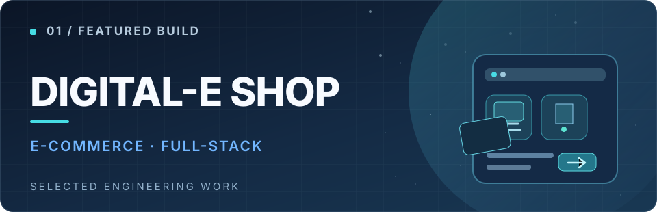
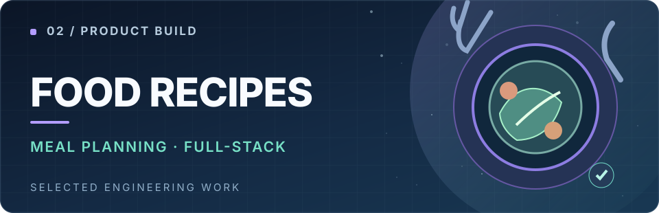
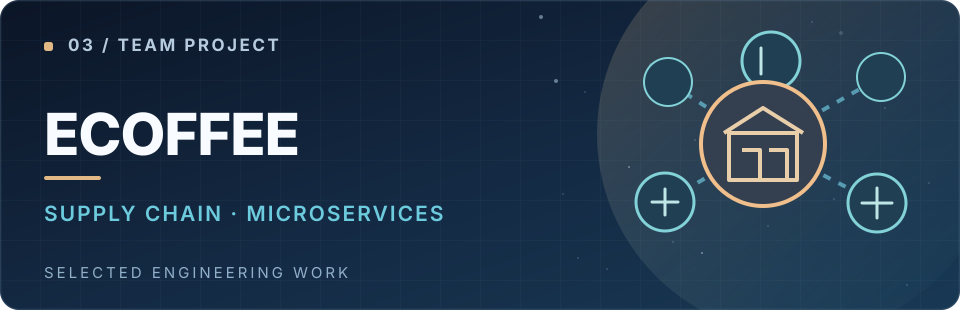
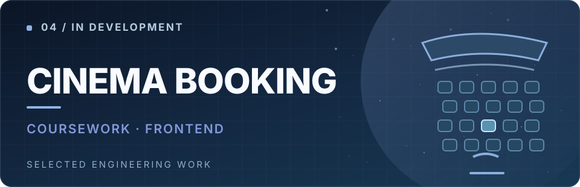

  <picture>
    <source media="(prefers-reduced-motion: reduce)" srcset="./assets/hero.svg" />
    
  </picture>

  <a href="https://quy-engineering-portfolio.memories2002.chatgpt.site/">Portfolio</a> &nbsp;·&nbsp;
  <a href="https://www.linkedin.com/in/memories2002/">LinkedIn</a> &nbsp;·&nbsp;
  <a href="mailto:manhphuquynguyen@gmail.com">Email</a> &nbsp;·&nbsp;
  <a href="https://github.com/memories-quy-2002?tab=repositories">Repositories</a>

## At a glance

<table width="100%">
  <tr>
    <td align="center" width="25%">
      <strong>FULL-STACK</strong> 
      Frontend + backend
    </td>
    <td align="center" width="25%">
      <strong>BACKEND-FOCUSED</strong> 
      APIs + systems
    </td>
    <td align="center" width="25%">
      <strong>HCMUT</strong> 
      Computer Science M.Sc. student
    </td>
    <td align="center" width="25%">
      <strong>OPEN TO WORK</strong> 
      Software engineering roles
    </td>
  </tr>
</table>

## About me

I'm **Nguyen Manh Phu Quy**, a full-stack software developer with a backend-focused mindset. I enjoy understanding the whole product — from the user interface to the API, data model, and delivery pipeline.

<table width="100%">
  <tr>
    <td width="33%" valign="top">
      <strong>What I build</strong> 
      Full-stack web applications that connect thoughtful experiences with dependable backend services.
    </td>
    <td width="33%" valign="top">
      <strong>How I think</strong> 
      Clear domain boundaries, practical trade-offs, maintainable code, and meaningful tests.
    </td>
    <td width="33%" valign="top">
      <strong>How I grow</strong> 
      Fast, deliberate learning through hands-on projects, collaboration, and graduate study.
    </td>
  </tr>
</table>

My experience includes frontend development at **TMA Solutions** and backend-focused engineering at **FPT Software**. I'm currently pursuing a **Master's in Computer Science at HCMUT**.

## Tech stack

<table>
  <tr>
    <th align="left" valign="middle">Backend & language</th>
    <td>
      
      
      
      
       TypeScript · Node.js · NestJS · Express
    </td>
  </tr>
  <tr>
    <th align="left" valign="middle">Frontend</th>
    <td>
      
      
      
      
       React · Vite · Tailwind CSS · Redux
    </td>
  </tr>
  <tr>
    <th align="left" valign="middle">Data & messaging</th>
    <td>
      
      
      
      
      
       PostgreSQL · MySQL · Prisma · Redis · Kafka
    </td>
  </tr>
  <tr>
    <th align="left" valign="middle">Tools & testing</th>
    <td>
      
      
      
      
       Docker · Git · GitHub Actions · Playwright
    </td>
  </tr>
</table>

Technology marks via <a href="https://github.com/devicons/devicon">Devicon</a> v2.17.0 (MIT). Logos belong to their respective owners.

## Selected projects

<table width="100%">
  <tr>
    <td width="50%" valign="top">
       
      <strong>Digital-E Shop</strong> 
      Electronics commerce with catalog discovery, checkout, order management, and an operations dashboard. Includes inventory and payment workflows.  
      <strong>Stack:</strong> React · TypeScript · NestJS · MySQL · Firebase 
      <a href="https://github.com/memories-quy-2002/digital-e-shop">Source code</a> &nbsp;·&nbsp; <a href="https://digital-e.vercel.app/">Live site</a>
    </td>
    <td width="50%" valign="top">
       
      <strong>Food Recipes</strong> 
      An integrated cooking workspace: recipe discovery, meal planning, shopping lists, pantry management, and cooking history.  
      <strong>Stack:</strong> React · NestJS · PostgreSQL · Prisma · TanStack Query 
      <a href="https://github.com/memories-quy-2002/Food-recipes">Source code</a> &nbsp;·&nbsp; <a href="https://foodrecipes1.vercel.app/">Live site</a>
    </td>
  </tr>
  <tr>
    <td width="50%" valign="top">
       
      <strong>eCoffee</strong> 
      Coffee franchise supply-chain team project. My backend contributions cover Warehouse, Inventory, Supplier, and Franchise services.  
      <strong>Stack:</strong> NestJS · PostgreSQL · Kafka · gRPC 
      <a href="https://ecoffee.cloud/">Project website</a>
    </td>
    <td width="50%" valign="top">
       
      <strong>Cinema Booking</strong> 
      A cinema management/coursework project. Its source repository is private and the current codebase remains an early frontend scaffold.  
      <strong>Stack:</strong> React · TypeScript · Vite 
      Private repository · Early scaffold
    </td>
  </tr>
</table>

Featured in priority order. For architecture notes, engineering decisions, and project context, see the <a href="https://quy-engineering-portfolio.memories2002.chatgpt.site/">portfolio</a> and linked repositories.

## Engineering principles

<table width="100%">
  <tr>
    <td width="50%" valign="top">
      <strong>01 / Clarity over cleverness</strong> 
      Readable code, explicit responsibilities, and boundaries that are easy to change.
    </td>
    <td width="50%" valign="top">
      <strong>02 / Reliability by design</strong> 
      Validate inputs, protect data, and handle failure paths deliberately.
    </td>
  </tr>
  <tr>
    <td width="50%" valign="top">
      <strong>03 / Evidence over assumptions</strong> 
      Use focused tests, profiling, and observability to guide engineering decisions.
    </td>
    <td width="50%" valign="top">
      <strong>04 / Practical software wins</strong> 
      Choose technology for product needs, not complexity for its own sake.
    </td>
  </tr>
</table>

## Current focus

<table width="100%">
  <tr>
    <td width="33%" valign="top">
      <strong>BUILDING</strong> 
      Maintaining and improving my full-stack projects, from UI to API.
    </td>
    <td width="33%" valign="top">
      <strong>LEARNING</strong> 
      Computer Science at the master's level, backend architecture, and systems design.
    </td>
    <td width="33%" valign="top">
      <strong>EXPLORING</strong> 
      Distributed systems, observability, and lightweight AI-assisted development.
    </td>
  </tr>
</table>

## Let's connect

I'm open to opportunities in **full-stack development, backend engineering, and software engineering**. If you're interested in my work or have an engineering challenge to discuss, I'd be happy to connect.

  <a href="https://quy-engineering-portfolio.memories2002.chatgpt.site/"><strong>PORTFOLIO</strong></a> &nbsp;&nbsp;·&nbsp;&nbsp;
  <a href="https://www.linkedin.com/in/memories2002/"><strong>LINKEDIN</strong></a> &nbsp;&nbsp;·&nbsp;&nbsp;
  <a href="mailto:manhphuquynguyen@gmail.com"><strong>EMAIL</strong></a> &nbsp;&nbsp;·&nbsp;&nbsp;
  <a href="https://github.com/memories-quy-2002?tab=repositories"><strong>GITHUB REPOS</strong></a>

Thoughtful engineering · Continuous learning · Useful products

