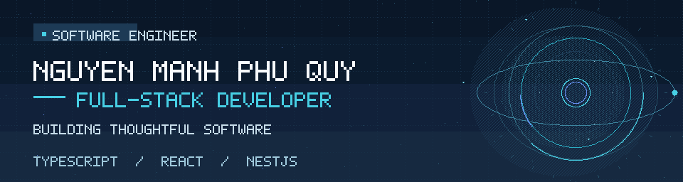

  <picture>
    <source media="(prefers-reduced-motion: reduce)" srcset="./assets/hero.svg" />
    
  </picture>

  <a href="https://quy-engineering-portfolio.memories2002.chatgpt.site/"><strong>Portfolio ↗</strong></a>&nbsp;&nbsp; · &nbsp;&nbsp;
  <a href="https://www.linkedin.com/in/memories2002/"><strong>LinkedIn ↗</strong></a>&nbsp;&nbsp; · &nbsp;&nbsp;
  <a href="mailto:manhphuquynguyen@gmail.com"><strong>Email ↗</strong></a>

Full-stack development &nbsp; / &nbsp; Backend engineering &nbsp; / &nbsp; Open to opportunities

## A little about me

I'm **Nguyen Manh Phu Quy**, a full-stack developer with a backend-focused mindset. I work across interfaces, APIs, and databases to build practical products that are easy to use and maintain.

- **Experience:** Backend-focused work at FPT Software, following frontend development experience at TMA Solutions.
- **Education:** Currently pursuing a Master's in Computer Science at Ho Chi Minh City University of Technology (HCMUT).
- **How I work:** Learn fast, communicate clearly, make deliberate trade-offs, and test what matters.

## Technologies I use

**Languages & backend**

  
  
  
  

TypeScript · Node.js · NestJS · Express

**Frontend**

  
  
  
  

React · Vite · Tailwind CSS · Redux Toolkit

**Data & messaging**

  
  
  
  
  

PostgreSQL · MySQL · Prisma · Redis · Kafka

**Developer tools**

  
  
  
  

Docker · Git · GitHub Actions · Playwright

Technology icons: <a href="https://github.com/devicons/devicon">Devicon</a> v2.17.0 (MIT). All trademarks remain with their respective owners.

## Selected work

### 01 — Digital-E Shop
**E-commerce platform · Personal project**

An electronics storefront and admin dashboard covering product discovery, checkout, payment flows, inventory, and order management.

**Stack:** React · TypeScript · NestJS · MySQL · Firebase

**[Source code ↗](https://github.com/memories-quy-2002/digital-e-shop)** &nbsp;·&nbsp; **[Live website ↗](https://digital-e.vercel.app/)**

### 02 — Food Recipes
**Recipe & meal-planning platform · Personal project**

A cooking workspace for discovering and publishing recipes, planning meals, managing shopping and pantry data, and tracking cooking progress.

**Stack:** React · NestJS · PostgreSQL · Prisma · TanStack Query

**[Source code ↗](https://github.com/memories-quy-2002/Food-recipes)** &nbsp;·&nbsp; **[Live website ↗](https://foodrecipes1.vercel.app/)**

### 03 — eCoffee
**Coffee franchise supply chain · Team project**

A service-based franchise platform. I contributed to four backend domains: **Warehouse, Inventory, Supplier, and Franchise**.

**Stack:** NestJS · PostgreSQL · Kafka · gRPC

**[Explore project ↗](https://ecoffee.cloud/)**

### 04 — Cinema Booking
**Cinema management · Coursework / early development**

A cinema booking and management concept. The current GitHub repository is private and its application code remains at an early scaffold stage.

**Stack:** React · TypeScript · Vite

*Private repository · In development*

---

## How I approach engineering

- **Keep it clear.** Favor readable code, explicit ownership, and maintainable boundaries.
- **Design for reliability.** Validate inputs, protect data, and plan for failures.
- **Use evidence.** Let tests, profiling, and observability inform decisions.
- **Stay pragmatic.** Choose the simplest solution that fits the actual requirements.

## Currently focused on

- **Building:** Refining full-stack projects from UI to API and deployment.
- **Learning:** Backend architecture and deeper computer science through graduate study.
- **Exploring:** Distributed systems, observability, and lightweight AI-assisted development.

---

## Let's connect

I'm open to **full-stack, backend, and software engineering opportunities**. If you'd like to talk about a project, an engineering problem, or a potential role, feel free to reach out.

**[View my portfolio ↗](https://quy-engineering-portfolio.memories2002.chatgpt.site/)** &nbsp;·&nbsp;
**[Connect on LinkedIn ↗](https://www.linkedin.com/in/memories2002/)** &nbsp;·&nbsp;
**[Send an email ↗](mailto:manhphuquynguyen@gmail.com)**

Thoughtful engineering. Continuous learning.

