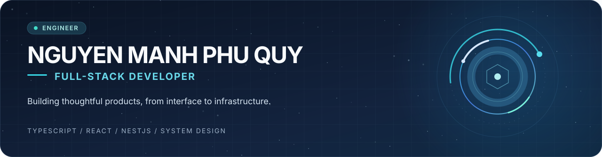
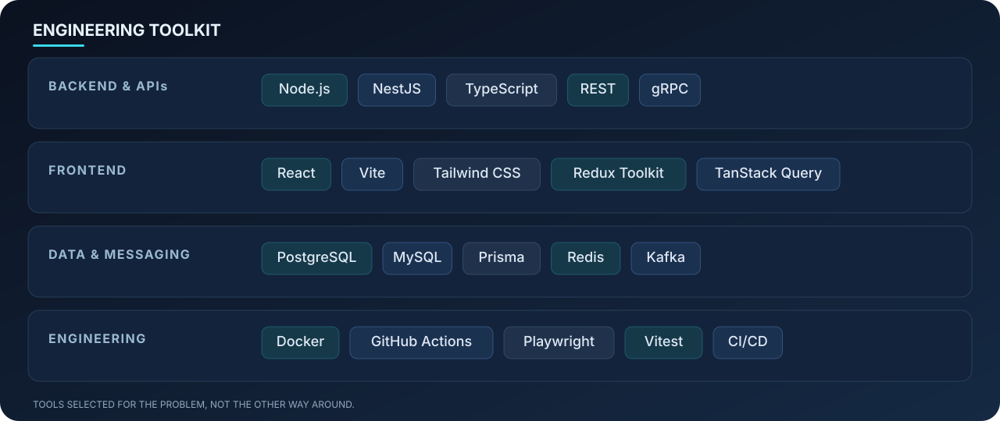

  

  <a href="https://quy-engineering-portfolio.memories2002.chatgpt.site/">Portfolio</a> &nbsp;·&nbsp;
  <a href="https://www.linkedin.com/in/memories2002/">LinkedIn</a> &nbsp;·&nbsp;
  <a href="mailto:manhphuquynguyen@gmail.com">Email</a> &nbsp;·&nbsp;
  <a href="https://github.com/memories-quy-2002?tab=repositories">Repositories</a>

## About me

I'm **Nguyen Manh Phu Quy**, a full-stack developer with a strong interest in backend engineering, system design, and practical product development. I build across the stack using **TypeScript, React, Node.js, and NestJS**, with a focus on maintainable architecture and reliable user experiences.

- **Experience:** Building backend engineering foundations at **FPT Software**, following earlier frontend development experience at **TMA Solutions**.
- **Education:** Pursuing a **Master's in Computer Science** at **Ho Chi Minh City University of Technology (HCMUT)**.
- **Approach:** Learn quickly, understand the trade-offs, write clear code, and test what matters.
- **Interests:** APIs, distributed systems, application architecture, developer tooling, and end-to-end product development.

## Tech stack

  

## Selected projects

| Project | What I built | Technology | Explore |
| --- | --- | --- | --- |
| **Digital-E Shop** | Full-stack electronics storefront and operations dashboard with product discovery, carts, checkout, payment workflows, and inventory management. | React · TypeScript · NestJS · MySQL · Firebase | [Code](https://github.com/memories-quy-2002/digital-e-shop) · [Live](https://digital-e.vercel.app/) |
| **Food Recipes** | Recipe discovery and publishing platform with meal planning, shopping lists, pantry management, and cooking history. | React · NestJS · PostgreSQL · Prisma · TanStack Query | [Code](https://github.com/memories-quy-2002/Food-recipes) · [Live](https://foodrecipes1.vercel.app/) |
| **eCoffee** | Coffee franchise management team project. I contributed to the **Warehouse, Inventory, Supplier, and Franchise** backend services. | NestJS · PostgreSQL · Kafka · gRPC | [Product](https://ecoffee.cloud/) |
| **Cinema Booking** | Cinema booking and management concept; its current GitHub repository is private and still at an early scaffold stage. | React · TypeScript · Vite | *Private / In development* |

> For architecture decisions and project context, explore the repositories or browse my [portfolio](https://quy-engineering-portfolio.memories2002.chatgpt.site/).

## Currently exploring

- **Backend architecture:** API design, domain boundaries, security, and maintainable services.
- **Distributed systems:** Messaging, consistency, observability, and failure handling.
- **Software delivery:** Meaningful tests, CI/CD, and practical automation.
- **Research & learning:** Deepening my computer science foundations through graduate study.

## Let's connect

I'm interested in **full-stack, backend, and software engineering opportunities**. Feel free to reach out about engineering challenges, projects, or collaboration.

**[Portfolio](https://quy-engineering-portfolio.memories2002.chatgpt.site/)** · **[LinkedIn](https://www.linkedin.com/in/memories2002/)** · **[Email](mailto:manhphuquynguyen@gmail.com)**

Thoughtful engineering. Continuous learning.

