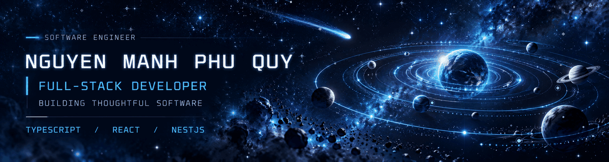
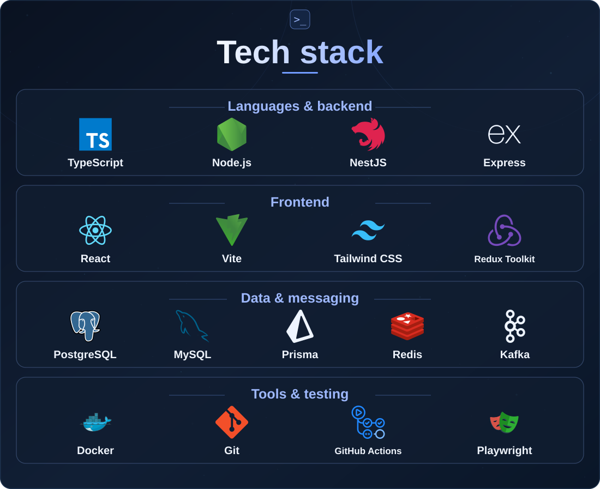

  <picture>
    <source media="(max-width: 640px)" srcset="./assets/hero-mobile.svg" />
    <source media="(prefers-reduced-motion: reduce)" srcset="./assets/hero.svg" />
    
  </picture>

  <a href="https://quy-engineering-portfolio.memories2002.chatgpt.site/"><strong>Portfolio ↗</strong></a> &nbsp; · &nbsp;
  <a href="https://www.linkedin.com/in/memories2002/"><strong>LinkedIn ↗</strong></a> &nbsp; · &nbsp;
  <a href="mailto:manhphuquynguyen@gmail.com"><strong>Email ↗</strong></a>

<strong>Software Engineering · Full-stack development · Open to opportunities</strong>

## About

I'm **Nguyen Manh Phu Quy**, a full-stack developer interested in building software that works well at every layer — from intuitive interfaces to reliable backend services.

I work with **TypeScript, React, Node.js, and NestJS**. My experience spans frontend development at **TMA Solutions** and backend-focused work at **FPT Software**. I'm currently pursuing a **Master's in Computer Science at HCMUT**.

I care about **clear architecture, practical trade-offs, meaningful tests, and continuous learning**.

  <picture>
    <source media="(max-width: 640px)" srcset="./assets/tech-stack-mobile.svg" />
    
  </picture>

Technology icons: <a href="https://github.com/devicons/devicon">Devicon</a> v2.17.0 (MIT); logos belong to their respective owners.

## Selected projects

### 01 · Digital-E Shop
*Full-stack e-commerce · Graduation project, independently maintained*

An electronics storefront and admin dashboard for product discovery, checkout, inventory, payments, and order management.

**Stack:** React · TypeScript · NestJS · MySQL · Firebase

**[GitHub ↗](https://github.com/memories-quy-2002/digital-e-shop)** &nbsp; · &nbsp; **[Live demo ↗](https://digital-e.vercel.app/)**

### 02 · Food Recipes
*Full-stack recipe platform · Internship-origin project, independently maintained*

A connected cooking workspace for recipe discovery, meal planning, shopping lists, pantry management, and cooking history.

**Stack:** React · NestJS · PostgreSQL · Prisma · TanStack Query

**[GitHub ↗](https://github.com/memories-quy-2002/Food-recipes)** &nbsp; · &nbsp; **[Live demo ↗](https://foodrecipes1.vercel.app/)**

### 03 · eCoffee
*Coffee franchise supply chain · Team project at FPT Software*

A service-based franchise platform. My contributions focused on the **Warehouse, Inventory, Supplier, and Franchise** backend services.

**Stack:** NestJS · PostgreSQL · Kafka · gRPC

**[Project website ↗](https://ecoffee.cloud/)**

### 04 · Cinema Booking
*Cinema management · Coursework / early development*

A cinema booking concept. Its source repository is **private** and the current application remains at an early scaffold stage.

**Stack:** React · TypeScript · Vite · *Private repository*

## Current focus

- **Building:** Improving independently maintained full-stack applications.
- **Learning:** Backend architecture and computer science through graduate study.
- **Exploring:** Distributed systems, observability, and lightweight AI-assisted development.

---

## Let's connect

I'm open to **full-stack, backend, and software engineering opportunities**.

**[Portfolio ↗](https://quy-engineering-portfolio.memories2002.chatgpt.site/)** &nbsp; · &nbsp; **[LinkedIn ↗](https://www.linkedin.com/in/memories2002/)** &nbsp; · &nbsp; **[Email ↗](mailto:manhphuquynguyen@gmail.com)**

Thoughtful engineering. Continuous learning.

